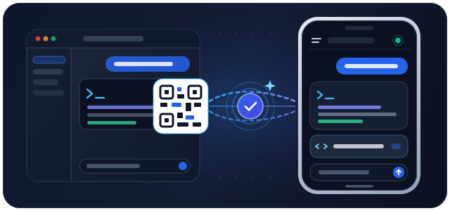
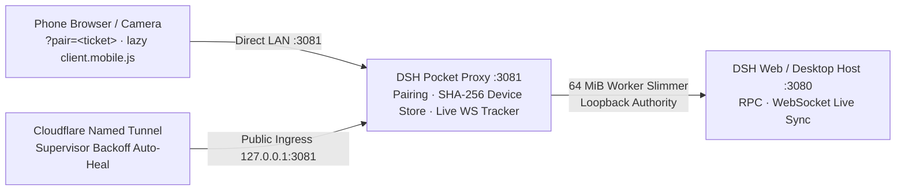

<p align="center">
  
</p>

<h1 align="center">DSH Pocket</h1>

<p align="center"><a href="README.en.md">English</a> | <a href="README.md">中文</a></p>

<p align="center">
  <a href="https://github.com/daha1216/dsh-pocket/releases/latest"></a>
  <a href="https://github.com/daha1216/dsh-pocket/actions/workflows/test.yml"></a>
  
  <a href="LICENSE"></a>
  <a href="https://github.com/daha1216/dsh-pocket/stargazers"></a>
  <a href="https://awesome-dsh-plugin.com"></a>
</p>

> Put **DeepSeek Harness in your pocket**: one package, one settings page — scan once on your PC screen for **one-step passwordless pairing** and persistent sessions across restarts, over zero-config LAN or your own self-healing Cloudflare Named Tunnel.

<p align="center">
  <a href="#-getting-started">Getting Started</a> &nbsp;·&nbsp;
  <a href="#-v40-highlights">Highlights</a> &nbsp;·&nbsp;
  <a href="#2-public-access-anywhere-via-cloudflare-named-tunnel">Public Tunnel</a> &nbsp;·&nbsp;
  <a href="#️-security-architecture-read-first">Security</a> &nbsp;·&nbsp;
  <a href="#-troubleshooting">Troubleshooting</a> &nbsp;·&nbsp;
  <a href="#-architecture-v40">Architecture</a> &nbsp;·&nbsp;
  <a href="CHANGELOG.md">Changelog</a>
</p>

<p align="center">
  ⭐ Drop a Star on GitHub if DSH Pocket helps your workflow &nbsp;·&nbsp; <a href="https://github.com/daha1216/dsh-pocket">Star on GitHub</a>
</p>

## What is this

**Use and control the DeepSeek Harness running on your computer, even when you are away from your desk.**

- On your commute, check live streaming agent output, inspect workspace source files, and approve tool calls right from your phone.
- Away from home or the office, send prompts or review code changes without setting up remote desktop or SSH.
- On a foldable phone or iPad, enjoy full desktop layout when unfolded/landscape and seamless drawer layout in Split View or folded mode.

With DSH Pocket installed, open **Settings → Phone access**, point your phone camera at the QR code, and **pair in a single step — no PIN typing, no secondary confirmation click on the PC** — while staying signed in across `dsh web` and DSH Desktop restarts.

<p align="center">
  
</p>

## ✨ v4.0 Highlights

| Feature | Description |
| --- | --- |
| ✨ **One-step scan-to-pair** | Localhost Settings mints 90-second single-use 128-bit CSPRNG pairing tickets (`?pair=<ticket>`). Scan with your phone camera for instant login — **zero password typing, zero PC confirmation click** — plus 8–64-char alphanumeric fallback PINs for manual link sign-in |
| 🔐 **Persistent login & per-device revocation** | Paired phones receive a 1-year `HttpOnly` device credential (`$DSH_HOME/dsh-pocket/devices.json` stores **only `sha256` hashes, never plaintext secrets**), surviving `dsh web` restarts and updates. Rename devices, see live `Online` status dots, and revoke individual or all devices (**instantly terminating active WebSockets**) |
| 📶 **Zero-config LAN access** | Works out of the box on the same Wi-Fi, automatically scoring physical NICs (**and reading the Windows host's physical NIC IPv4 under WSL2**), with one-click LAN toggle and manual IPv4 override for Tailscale/VPN setups |
| 🌐 **Self-configured Cloudflare Named Tunnel** | Supports your own fixed domain via **Cloudflare Named Tunnels** (no ephemeral Quick Tunnel). Includes a 2-step inline setup guide and one-click local target URL (`http://127.0.0.1:3081`) copy; stays off until configured |
| 🛡️ **Tunnel Supervisor & preflight diagnostics** | Built-in **Named Tunnel Supervisor** auto-reconnects dropped `cloudflared` processes with jittered exponential backoff (`2s → 60s`) and trips a circuit breaker on fatal auth/config errors; proactively warns when **Clash / sing-box TUN** virtual adapters or **port shifts** are detected |
| 📱 **Host UI mobile adaptation** | Responsive drawer navigation, safe-area & virtual-keyboard handling, fixed foldable/iPad `auto` dynamic layout switching, independent mobile font sizing (`12–22 px` or follow desktop), pinch-zoom toggle, and right-sidebar toggle |
| 📄 **Mobile file preview bottom sheet** | Tap any workspace file link in AI responses to open a sleek bottom-sheet code viewer with line numbers, 128 KB smart truncation, one-tap Copy All, and Escape / Android Back support (toggleable in Settings) |
| ⚡ **Worker slimming & zero-overhead desktop split** | Offloads decompression, projection slimming, and Brotli recompression of massive `session/list` payloads (up to **64 MiB**) to pooled `worker_threads`; splits client output into `client.js` + lazy `client.mobile.js` so desktop browsers pay zero mobile bundle cost |

## 🚀 Getting Started

**Prerequisite**: [DeepSeek Harness](https://github.com/deepseek-ai/deepseek-harness) installed (**DSH `0.2.0-rc.1` or newer**, compatible across both `0.2.0–0.2.1` and `0.2.2+` host generations, Node.js `>= 22`).

```sh
# Install the dsh CLI globally if needed:
npm install -g @deepseek-ai/dsh

# 1. Install or update DSH Pocket from GitHub
dsh plugin --profile web add github:daha1216/dsh-pocket -w

# 2. Start or restart dsh web
dsh web
```

> [!IMPORTANT]
> **Package source**: The `dsh-pocket` package on npm belongs to the original upstream author's 2.x line. Always install v4.x from `github:daha1216/dsh-pocket` (or pin a specific release tag via `dsh plugin --profile web add github:daha1216/dsh-pocket#v4.0.1 -w`).

> [!TIP]
> **Upgrading from v3.x to v4.0**: Re-run the `add` command above and restart `dsh web` (or click Restart in the Settings banner). Existing LAN/public preferences, PINs, and Named Tunnel tokens carry over automatically; Lite View (`/__dsh-pocket/lite`) and the Usage Probe have been retired in favor of a single, deeply polished host-UI experience.

After restarting `dsh web`, open **Settings → Phone access** (or **Plugins → DSH Pocket**):

<p align="center">
  
</p>

### 1. LAN Access (Same Wi-Fi, Zero Config)

1. Connect your phone and computer to the same Wi-Fi network (or connect your computer to your phone's hotspot).
2. Open **Settings → Phone access** on your computer and select the **📶 LAN access** tab.
3. Point your phone camera at the QR code (`✨ One-step scan to pair`). Your phone pairs immediately without typing a PIN and opens your live DSH workspace.
4. Your phone now appears under **Authorized devices** and stays signed in across `dsh web` restarts until you revoke it.

> **Fallback PINs & No-PIN LAN mode**: Expand **Advanced & maintenance** at the bottom of the page if you want to view, rotate, or customize the 8–64 character fallback PIN for manual browser sign-in, or turn off LAN PIN protection on a trusted home network.

### 2. Public Access (Anywhere via Cloudflare Named Tunnel)

**Random temporary domains (Quick Tunnel) are not supported.** Public access uses your own Cloudflare account, domain, and Named Tunnel Token, and remains off until configured:

1. In [Cloudflare Zero Trust](https://one.dash.cloudflare.com/) → **Networks → Tunnels**, create a Cloudflared Named Tunnel and copy its **Tunnel Token**.
2. Add a **Public Hostname** route (e.g. `pocket.example.com`) and point its **Service** to the **Local target service URL** shown in Settings (normally `http://127.0.0.1:3081`, copyable with one click).
3. In **Settings → Phone access → 🌐 Public domain**, enter your fixed domain and Tunnel Token, then click **Save** (saving stores configuration without starting the tunnel).
4. Flip the Public switch on (or click **Enable public access**), accept the security notice, and wait for the tunnel to connect (`cloudflared` downloads automatically on first run).
5. Scan the public QR code on your computer screen to pair your phone for public access (or sign in remotely using your public fallback PIN, which also registers the device in Authorized devices).

> [!WARNING]
> Always point your Cloudflare Public Hostname **Service** to Pocket's proxy port (`http://127.0.0.1:3081` by default) — **never** directly to DSH's raw port (`3080`), which would bypass Pocket's pairing and authentication gate.

> **Auto-heal & auto-restore**: While public access is enabled, the Named Tunnel Supervisor automatically heals dropped `cloudflared` connections in the background and restores active named tunnels across DSH restarts. Turn the Public switch off whenever you want to close external access.

## ⚠️ Security Architecture (Read First)

- **Full host capability**: DSH can read/write files and execute commands on your machine. Only pair your own devices, never share pairing QR codes or fallback PINs, and verify compliance before enabling public tunnels on corporate networks.
- **Strict channel isolation**: `LAN` and `Public` pairing tickets and device cookies are strictly isolated — **a LAN-paired device credential can never authenticate over the public tunnel**, and visitors arriving over the public tunnel cannot view the device list, LAN PINs, or tunnel configuration, nor trigger factory reset.
- **Hashed device secrets & instant WebSocket revocation**: Pairing tickets (90s TTL, atomic single-use burn) and persistent device tokens store only `sha256` hashes verified via constant-time `crypto.timingSafeEqual`. Clicking **Revoke** removes the device record and immediately calls `socket.destroy()` on all live WebSockets belonging to that device.
- **Scoped PIN rotation**: Rotating or customizing a channel's fallback PIN immediately revokes PIN-authenticated sessions on that channel while keeping QR-paired (`pair`) devices intact. **Factory reset** wipes local settings, rotates all fallback PINs and cookie secrets, stops the tunnel, and disconnects every device.
- **Query & log scrubbing**: Both `?pair=<ticket>` and `?token=<PIN>` are stripped via `302` redirect upon redemption and scrubbed from upstream URLs, `Referer` headers, and proxy logs.
- **Brute-force rate limiting**: 5 failed attempts per IP trigger a 60-second lock; global failure spikes activate token-bucket throttling while exempting previously authenticated client IPs from denial-of-service lockout.
- **Fail-closed host classification**: Every non-loopback, non-RFC1918/CGNAT hostname is treated as **public**. Do not override `HTTP Host Header` in Cloudflare tunnel routes; if placing Nginx / Caddy / Traefik in front of port `3081`, preserve `X-Forwarded-For` / `X-Real-IP` / `Forwarded`.

## 💻 DSH Desktop Notes

- QR pairing, live mobile sync, and persistent device sessions work seamlessly inside **DSH Desktop**; process lifecycle is managed by the desktop app (in-page restart banners are automatically hidden).
- Desktop **advanced mode** disables the web layout service required by mobile clients — keep DSH Desktop in **compatibility mode** for phone access.

## 🩹 Troubleshooting

| Symptom | Cause & Solution |
| --- | --- |
| Public URL returns `error 1033` or stalls while connecting | A local proxy/VPN (**Clash, Mihomo, Surge, sing-box TUN / Enhanced mode**) is intercepting `cloudflared` edge connections (`*.argotunnel.com`). Check the yellow TUN preflight banner in Settings: **disable TUN mode** or add `DIRECT` rules for `cloudflared` and `argotunnel.com` (`HTTP_PROXY`/`HTTPS_PROXY` env vars are already stripped automatically). |
| Local proxy port shifted from `3081` | When `3081` is busy, DSH Pocket binds an available port and displays a **Port Shift warning** with the exact `http://127.0.0.1:<port>` target URL. Update your Cloudflare Public Hostname Service URL accordingly, or set `"proxyPort": 3082` in `$DSH_HOME/dsh-pocket/settings.json`. |
| `cloudflared` download blocked on remote Linux | Install `cloudflared` manually (in `PATH` or `$DSH_HOME/dsh-pocket/bin/cloudflared`), or set `"cloudflaredPath": "/abs/path/to/cloudflared"` in `$DSH_HOME/dsh-pocket/settings.json` and restart `dsh web`. |
| `ERR_PNPM_ADDING_TO_ROOT` | Append `-w` (`--workspace-root`) to `dsh plugin ... add` commands. |
| Changes not visible after updating | Restart `dsh web` (or click **Restart dsh web to apply** in the Settings banner) so the host loads the updated plugin code. |

## 🗂 Architecture (v4.0)



| Path | Responsibility |
| --- | --- |
| `src/shared/protocol.ts` & `client/api.js` | Shared RPC endpoint contracts, DOM attribute/event constants, and status redaction |
| `lib/index.js` & `lib/web-rpc.js` | Host plugin entry & RPC router with dual-generation DSH `0.2.0–0.2.2+` launch-token and `Peer` route admission support |
| `lib/auth/` | `pairing.mjs` (CSPRNG single-use pairing tickets) & `device-store.mjs` (persistent hashed device registry + live WebSocket tracking/revocation) |
| `lib/settings.mjs` | In-memory `O(1)` cached snapshot + serialized non-blocking atomic disk persistence (`tmp` + `rename` + `.bak`) |
| `lib/service.mjs` & `lib/preflight.mjs` | Proxy lifecycle, Named Tunnel Supervisor backoff & circuit breaker, and TUN/port-shift preflight diagnostics |
| `lib/proxy.mjs` & `lib/proxy/` | Header-rewriting proxy, `?pair=` & `/pocket-login` auth flows, dark-mode bilingual proxy pages (`pages.mjs`), `<0.2ms` `/__dsh-pocket/ping`, and 64 MiB `worker_threads` `session/list` slimming (`slim-worker.mjs`) + unified LRU cache |
| `client/settings/` | TypeScript/TSX 4-zone Settings UI aligned with DSH Official R20 / `0.5px` / `--dsw-alias-*` styling and self-owned accessible primitives/icons |
| `client/mobile/` | First-class internalized mobile adaptation engine (drawer chrome, focus domain, panel stack, foldable `auto` support, `file-preview-sheet.ts`) |
| `client/build.mjs` | Dual-chunk `esbuild` bundler producing desktop-light `client/client.js` (`meta.stylesheets`) and lazy-loaded `client/client.mobile.js` |

## 🛠 Local Development

```sh
npm install
npm run typecheck      # Strict TypeScript check
npm run build          # Bundle client/client.js + client/client.mobile.js
npm test               # Run unit & integration test suites
```

See [LOCAL-DEV.md](./LOCAL-DEV.md) for symlink instructions to test local edits directly inside a live `dsh web` instance.

## 🤝 Credits & License

- Licensed under **[GPL-2.0](LICENSE)**.
- Originally forked from [shaobeichen/dsh-pocket](https://github.com/shaobeichen/dsh-pocket) (GPL-2.0) with mobile adaptation derived from [mexiaosqwq/dsh-web-mobile](https://github.com/mexiaosqwq/dsh-web-mobile) (MIT, notice retained in `client/mobile/LICENSE.dsh-web-mobile`), evolving independently as first-class source starting in v4.0. See [NOTICE.md](./NOTICE.md) for full attribution details.
- Public tunnel powered by [Cloudflare Tunnel (`cloudflared`)](https://github.com/cloudflare/cloudflared).

---

**Questions or feedback?** Open an issue at [GitHub Issues](https://github.com/daha1216/dsh-pocket/issues).
