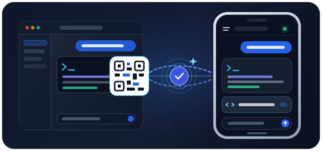
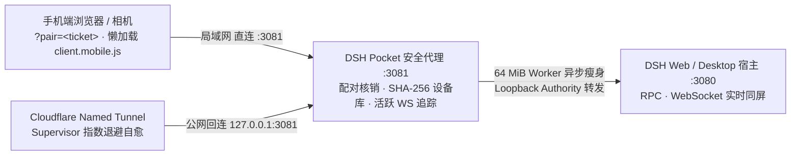

<p align="center">
  
</p>

<h1 align="center">DSH Pocket</h1>

<p align="center"><a href="README.en.md">English</a> | <a href="README.md">中文</a></p>

<p align="center">
  <a href="https://github.com/daha1216/dsh-pocket/releases/latest"></a>
  <a href="https://github.com/daha1216/dsh-pocket/actions/workflows/test.yml"></a>
  
  <a href="LICENSE"></a>
  <a href="https://github.com/daha1216/dsh-pocket/stargazers"></a>
  <a href="https://awesome-dsh-plugin.com/zh/"></a>
</p>

> 把 **DeepSeek Harness 装进你的口袋**：一个包、一个设置页，电脑屏幕扫一次二维码即可**免输密码一步直连**并持久保持登录；局域网零配置即用，公网支持自配 Cloudflare 固定域名隧道与断线自动自愈。

<p align="center">
  <a href="#-快速开始">快速开始</a> &nbsp;·&nbsp;
  <a href="#-v40-核心体验">核心体验</a> &nbsp;·&nbsp;
  <a href="#方式二公网固定域名人在外面自配-cloudflare-命名隧道">公网固定域名</a> &nbsp;·&nbsp;
  <a href="#️-安全机制与注意事项必读">安全架构</a> &nbsp;·&nbsp;
  <a href="#-常见问题与公网隧道排障">排障指南</a> &nbsp;·&nbsp;
  <a href="#-项目架构v40">架构说明</a> &nbsp;·&nbsp;
  <a href="CHANGELOG.md">更新日志</a>
</p>

<p align="center">
  ⭐ 顺手留颗 Star，大哈能高兴一整天 &nbsp;·&nbsp; <a href="https://github.com/daha1216/dsh-pocket">好，这就去 Star</a>
</p>

## 这是什么

**你不在电脑前，也想随时查看并操控电脑上的 DeepSeek Harness。**

- 下班路上，Agent 在电脑上跑长任务，掏出手机就能实时看流式输出、预览工作区代码文件、点工具审批
- 出门在外，想让家里或办公室电脑上的 DSH 查资料、改代码，无需折腾远程桌面或 SSH
- 折叠屏或 iPad 展开时用宽屏工作台，合上或分屏时自动切回单手抽屉布局

DSH Pocket 就是为此设计的：**安装插件后，打开设置 →「手机访问」，用手机相机扫一下二维码，无需输入密码、无需在电脑二次点确认，一步配对即可实时操控电脑上的 DSH 完整界面**，且重启 `dsh web` 或桌面客户端后手机依然保持登录。

<p align="center">
  
</p>

## ✨ v4.0 核心体验

| 特性 | 说明 |
| --- | --- |
| ✨ **扫码免输密一步直连** | 本机设置页实时签发 90 秒有效期的 128-bit CSPRNG 一次性配对票据（`?pair=<ticket>`），手机扫码即完成配对并建立会话——**免输密码、免电脑二次确认、用完即焚**；同时保留 8–64 位备用密码供纯链接手动登录 |
| 🔐 **跨重启持久登录 & 设备独立管理** | 配对或密码登录的手机写入 1 年期 `HttpOnly` 设备凭证（服务端 `$DSH_HOME/dsh-pocket/devices.json` **仅存 `sha256` 哈希，不落明文**），**`dsh web` 重启或升级后免重新登录**；设置页实时展示在线绿点、支持设备重命名、单台移除或全部移除（**立即掐断该设备的活跃 WebSocket 连接**） |
| 📶 **局域网零配置直连** | 同一 Wi-Fi 下装好即用，自动优选物理网卡 IPv4（**WSL2 自动穿透读取 Windows 宿主机物理网卡 IP**），支持一键开关局域网通道与手动指定 Tailscale/虚拟局域网网卡 |
| 🌐 **自配 Cloudflare 固定域名隧道** | 仅支持用户自配的 **Cloudflare 命名隧道（Named Tunnel）**，地址固定不变；内置两步配置向导与本地目标服务地址（`http://127.0.0.1:3081`）一键复制，未配置时公网保持关闭 |
| 🛡️ **隧道守护自愈 & 环境预检** | 内置 **Named Tunnel Supervisor**：`cloudflared` 意外退出时按指数退避（`2s → 60s` 带抖动）自动重连，遇 Token 无效或连续秒退自动熔断；设置页主动检测 **Clash / sing-box TUN 虚拟网卡**与**端口偏移**并给出排障提示 |
| 📱 **宿主桌面 UI 移动端深度适配** | 窄屏自动切换侧栏抽屉布局，完美适配安全区、虚拟键盘抬升与触控手势；修复折叠屏与 iPad `auto` 模式动态横竖屏/分屏切换；支持独立字号（`12–22 px` 或跟随桌面）、双指捏合缩放开关与右边栏开关 |
| 📄 **代码文件底部预览抽屉** | 手机点击会话中的工作区文件路径时，直接从底部弹出带行号的代码预览面板（支持 128 KB 智能截断、全文一键复制与手势/返回键关闭；可在设置页切换回仅提示模式） |
| ⚡ **Worker 异步瘦身 & 桌面零负担分包** | 超大会话列表（最高 **64 MiB**）放入后台 `worker_threads` 异步解压、裁剪与 Brotli 重压，主线程零阻塞；客户端采用双产物懒加载（`client.js` + `client.mobile.js`），纯桌面端零移动端脚本开销 |

## 🚀 快速开始

**前提**：电脑上已安装 [DeepSeek Harness](https://github.com/deepseek-ai/deepseek-harness)（要求 **DSH `0.2.0-rc.1` 及以上**，完整兼容 `0.2.0–0.2.2+` 双代宿主接口，Node.js `>= 22`）。

```sh
# 若尚未全局安装 dsh CLI：
npm install -g @deepseek-ai/dsh

# 1. 安装或更新插件（单包内置服务端代理与客户端界面）
dsh plugin --profile web add github:daha1216/dsh-pocket -w

# 2. 启动或重启 dsh web
dsh web
```

> [!IMPORTANT]
> **安装来源说明**：npm 上的同名 `dsh-pocket` 为上游原作者历史版本，请务必使用上方 `github:daha1216/dsh-pocket` 地址安装 v4.x。如需锁定特定版本，可执行 `dsh plugin --profile web add github:daha1216/dsh-pocket#v4.0.1 -w`。

> [!TIP]
> **从 v3.x 升级到 v4.0**：重跑一次上方的 `add` 命令并重启 `dsh web`（或点击设置页顶部黄条重启）即可。原有的局域网/公网配置、密码与命名隧道 Token 会自动延续；v4.0 已移除独立轻量视图（`/__dsh-pocket/lite`）与使用探针，全面聚焦扫码一步直连与宿主 UI 移动端体验。

安装并重启后，打开 DSH 左下角 **设置 →「手机访问」**（或在 **插件 → DSH Pocket** 中打开设置）：

<p align="center">
  
</p>

### 方式一：局域网访问（同一 Wi-Fi，零配置）

1. 手机与电脑连接同一 Wi-Fi（或电脑连接手机热点）。
2. 在电脑本机打开 **设置 → 手机访问**，顶部选择 **「📶 局域网访问」**。
3. 用手机系统相机直接扫描二维码（带 `✨ 扫码免输密一步直连` 标记），手机浏览器将自动完成设备配对并进入 DSH 主界面。
4. 配对后的手机会出现在下方 **「已授权设备」** 卡片中；后续即使电脑重启 `dsh web`，手机重新打开页面也无需再次扫码或输密码。

> **备用密码与局域网免密开关**：若不便扫码（如直接在手机浏览器手输地址），可在底部展开 **「高级选项与维护」** 查看、轮换或自定义 8–64 位局域网备用密码，也可在可信家庭网络下关闭局域网密码保护。

### 方式二：公网固定域名（人在外面，自配 Cloudflare 命名隧道）

**本插件不提供随机临时公网域名（无 Quick Tunnel）**，公网访问完全走你自己的 Cloudflare 账号与域名，未配置时保持关闭：

1. 登录 [Cloudflare Zero Trust](https://one.dash.cloudflare.com/) → **Networks → Tunnels**，创建一条命名隧道（Cloudflared），复制生成的 **Tunnel Token**。
2. 在该隧道的 **Public Hostname** 页面添加你的域名（如 `pocket.example.com`），将 **Service** 指向设置页显示的**本地目标服务地址**（默认 `http://127.0.0.1:3081`，可在设置页一键复制）。
3. 回到电脑端 **设置 → 手机访问 →「🌐 公网固定域名」**，填入固定域名与 Tunnel Token 并点击 **保存**（仅保存配置，不会自动开启公网）。
4. 打开右上角公网开关（或点击 **「开启公网访问」**），阅读并勾选安全声明后启动隧道（首次启动会自动下载 `cloudflared`）。
5. 隧道连通后，在本机用手机扫公网二维码即可一步配对并签发公网授权设备凭证（也可在外出时打开固定域名输入公网备用密码登录，同样会自动记入授权设备列表）。

> [!WARNING]
> Cloudflare Public Hostname 中的 **Service** 务必指向设置页显示的 Pocket 代理地址（默认 `http://127.0.0.1:3081`），**切勿**填成 DSH 原始端口 `3080`，否则公网请求会绕过 Pocket 的配对与密码认证栅栏。

> **断线自愈与重启恢复**：开启状态下的命名隧道若遇网络波动或 `cloudflared` 异常退出，内置守护器会自动退避重连；重启 `dsh web` 时也会自动恢复此前保持开启的命名隧道。用完不想暴露公网时，随手关闭公网开关即可。

## ⚠️ 安全机制与注意事项（必读）

- **完整主机权限提醒**：DSH 能够在你的电脑上读写文件并执行终端命令。请仅授权你本人的移动设备，切勿将配对二维码、固定域名或备用密码分享给他人；在企业或涉密网络中请先确认安全合规。
- **严格通道隔离（Channel Isolation）**：`局域网` 与 `公网` 的配对票据及设备凭证严格隔离——**通过局域网扫码配对的设备绝不能用于访问公网隧道**；公网访客打开设置页时也无法查看设备列表、局域网密码、隧道配置或执行恢复出厂设置。
- **零明文凭据落盘 & 即时吊销**：一次性配对票据（90s TTL，单次原子核销）与持久设备密钥在服务端均只保存 `sha256` 摘要并以 `crypto.timingSafeEqual` 恒定时间比对；点击「移除」设备会立即销毁其底层活跃 WebSocket 连接，被移除设备瞬间断流下线。
- **备用密码变更联动失效**：在「高级选项与维护」中换新或修改某通道的备用密码时，此前通过备用密码登录的该通道设备会话会自动失效，而通过电脑屏幕扫码授权的设备不受影响；执行「恢复出厂设置」则会清空全部配置、轮换所有密码与签名密钥并断开全部设备。
- **URL 与日志脱敏**：无论是 `?pair=<ticket>` 还是 `?token=<PIN>`，代理验证通过后都会以 `302` 剥离敏感查询参数，并在上游转发 URL、`Referer` 请求头及访问日志中彻底抹除，防止凭据滞留在浏览器历史记录或日志文件中。
- **防暴力破解限速**：单 IP 连续验证失败 5 次（含无效/过期配对码或错误密码）锁定 60 秒；触发全局异常阈值时启用全局令牌桶限流，同时保障已成功登录过的可信来源不被陌生扫描流量连坐锁死。
- **反向代理与 Host Header 说明**：除回环与私网地址外的一切域名一律按 **公网（fail-closed）** 强制认证。Cloudflare Public Hostname 路由**请勿**自定义覆盖 `HTTP Host Header`；若自行前置 Nginx / Caddy / Traefik 反代指向 `3081`，请保留 `X-Forwarded-For` / `X-Real-IP` / `Forwarded` 头。

## 💻 DSH Desktop（桌面客户端）说明

- 在 DSH Desktop 中，扫码配对、手机同屏与持久会话同样开箱即用；进程重启由桌面客户端自身管理（设置页内的重启横幅会自动隐藏）。
- 桌面端若开启了实验性的 **advanced 模式**（禁用 Web 布局服务），手机端将无法获取布局服务并会展示模式提示，请切回默认的 **compatibility 模式** 后重启桌面端。

## 🩹 常见问题与公网隧道排障

| 现象 | 原因与解决方法 |
| --- | --- |
| 公网报错 `error 1033` / 一直卡在连接边缘 | 本机开启了 **Clash / Mihomo / Surge / sing-box 的 TUN（虚拟网卡/增强）模式**，劫持了 `cloudflared` 到 `*.argotunnel.com` 的连接。设置页顶部会主动弹出黄色 TUN 预检警告：**关闭代理软件的 TUN 模式**，或将 `PROCESS-NAME,cloudflared,DIRECT` 与 `DOMAIN-SUFFIX,argotunnel.com,DIRECT` 加入直连规则即可（`HTTP_PROXY` 等环境变量已由插件自动剥离）。 |
| 本地代理端口不是 `3081` | 若 `3081` 被占用，插件会自动顺延端口并在公网页弹出**端口偏移提醒**。复制设置页显示的实际 `http://127.0.0.1:<端口>` 更新到 Cloudflare Public Hostname 的 Service 即可，或在 `$DSH_HOME/dsh-pocket/settings.json` 中设置 `"proxyPort": 3082`。 |
| 远程 Linux 无法自动下载 `cloudflared` | 手动安装 `cloudflared`（放入系统 `PATH` 或 `$DSH_HOME/dsh-pocket/bin/cloudflared`），或在 `$DSH_HOME/dsh-pocket/settings.json` 中写入 `"cloudflaredPath": "/绝对路径/cloudflared"` 后重启 `dsh web`。 |
| `ERR_PNPM_ADDING_TO_ROOT` | pnpm 工作区限制，安装/更新命令末尾务必带上 `-w`。 |
| 更新插件后界面没变化 | 重新执行 `dsh plugin --profile web add github:daha1216/dsh-pocket -w` 后，**必须重启 `dsh web`**（或在设置页顶部黄条点击「重启 dsh web 生效」）。 |

## 🗂 项目架构（v4.0）



| 路径 | 职责说明 |
| --- | --- |
| `src/shared/protocol.ts` & `client/api.js` | 前后端共享 RPC 端点、DOM 属性/事件常量与状态脱敏契约 |
| `lib/index.js` & `lib/web-rpc.js` | 插件主入口与 RPC 路由（兼容 DSH `0.2.0–0.2.2+` 双代认证与 `Peer` 准入机制） |
| `lib/auth/` | `pairing.mjs`（CSPRNG 单次配对票据）与 `device-store.mjs`（持久设备哈希存储与实时 Socket 追踪吊销） |
| `lib/settings.mjs` | 内存快照 + 异步串行原子落盘（`tmp` + `rename` + `.bak`），零主线程阻塞 |
| `lib/service.mjs` & `lib/preflight.mjs` | 代理生命周期、Named Tunnel Supervisor 指数退避自愈与熔断、TUN/端口偏移环境预检 |
| `lib/proxy.mjs` & `lib/proxy/` | 改头反向代理、`/pocket-login` 与 `?pair=` 认证流、自适应深浅色中英双语代理页（`pages.mjs`）、`/__dsh-pocket/ping` 零 I/O 探活、`slim-worker.mjs` 64 MiB 异步会话瘦身与统一预算缓存 |
| `client/settings/` | 基于 DSH 官方 R20 / `0.5px` / `--dsw-alias-*` 设计规范重写的 TypeScript/TSX 四分区设置页（零外部 UI 原语运行时依赖） |
| `client/mobile/` | 第一公民化的移动端适配引擎（抽屉导航、焦点域与面板栈、折叠屏 `auto` 动态适配、`file-preview-sheet.ts` 代码预览抽屉） |
| `client/build.mjs` | `esbuild` 双产物打包器：生成轻量入口 `client/client.js`（含 `meta.stylesheets`）与按需懒加载分包 `client/client.mobile.js` |

## 🛠 本地开发

```sh
npm install
npm run typecheck      # TypeScript 严格类型检查
npm run build          # 构建双分包 client/client.js 与 client/client.mobile.js
npm test               # 运行全套单元与集成测试
```

想要把本地仓库软链进本机 `~/.dsh` 实时联调？详见 [LOCAL-DEV.md](./LOCAL-DEV.md)。

## 🤝 致谢与许可

- 本项目以 **[GPL-2.0](LICENSE)** 开源发布。
- 早期基础架构源自 [shaobeichen/dsh-pocket](https://github.com/shaobeichen/dsh-pocket)（GPL-2.0），移动端宿主适配层源自 [mexiaosqwq/dsh-web-mobile](https://github.com/mexiaosqwq/dsh-web-mobile)（MIT，许可声明保留于 `client/mobile/LICENSE.dsh-web-mobile`），自 v4.0 起作为独立代码库自主演进；完整归属声明见 [NOTICE.md](./NOTICE.md)。
- 公网加密隧道能力基于 [Cloudflare Tunnel (`cloudflared`)](https://github.com/cloudflare/cloudflared)。

---

**遇到问题或有建议？** 欢迎前往 [GitHub Issues](https://github.com/daha1216/dsh-pocket/issues) 反馈交流。
